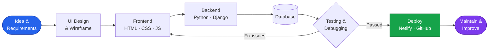
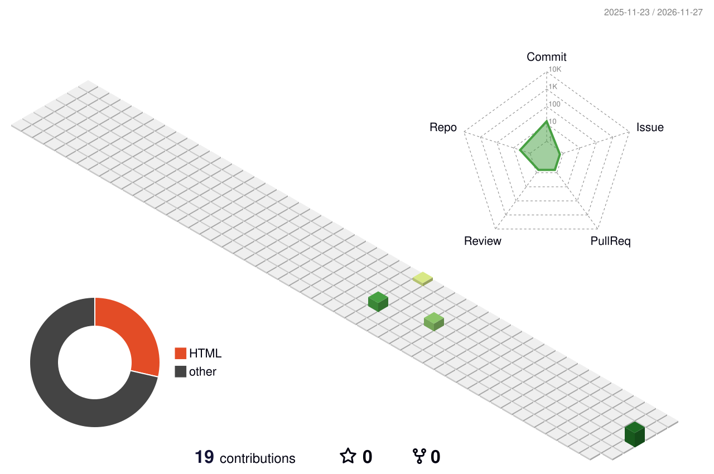
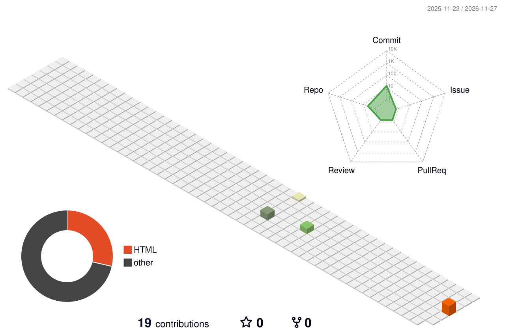

B.Tech CSE (AI &amp; ML) student building modern, responsive websites and full stack web applications.

---

## About Me

I'm a full stack developer with hands-on experience in building real-world websites and web applications. I work on responsive frontends with HTML, CSS and JavaScript, and on backends with Python and Django. I'm currently strengthening my fundamentals in Data Structures & Algorithms and working towards a career as a professional Full Stack Developer.

- 🎓 B.Tech in Computer Science (AI & ML)
- 💻 Frontend development: HTML, CSS, JavaScript
- 🐍 Backend development: Python, Django
- 📚 Currently learning: Data Structures & Algorithms, advanced Django, full stack architecture
- 🤝 Open to internships, entry-level roles and freelance opportunities

---

## Tech Stack

| Category | Technologies |
|---|---|
| **Frontend** | HTML, CSS, JavaScript, Responsive Design |
| **Backend** | Python, Django |
| **Languages** | Python, Java, JavaScript |
| **Tools** | Git, GitHub, VS Code |

---

## Skill Radar

---

## My Development Workflow

---

## Featured Projects

| Project | Description | Tech Stack | Link |
|---|---|---|---|
| **Sky Vision Group Consultancy** | Responsive consultancy website with multiple pages and a clean, professional layout. | HTML, CSS, JavaScript | [Live Demo](https://skyvisiongroupofconsultancy.netlify.app/) |
| **Trivera Social Foundation** | Website for a social foundation focused on community support and social impact. | HTML, CSS, JavaScript | [Live Demo](https://triverasocialfoundations.netlify.app/) |
| **E-Ride Care** | EV services web application with service-related features and complete user workflows. | HTML, CSS, JavaScript, Python | — |
| **Django Web Applications** | Full stack apps with admin panels, dynamic pages and database integration. | Python, Django, Database, JavaScript | — |

---

## 🧊 3D Contribution Graph

---

## GitHub Stats

 

---

## Contribution Activity

  

<picture>
  <source media="(prefers-color-scheme: dark)" srcset="https://raw.githubusercontent.com/harilalkumar1007/harilalkumar1007/output/github-contribution-grid-snake-dark.svg">
  <source media="(prefers-color-scheme: light)" srcset="https://raw.githubusercontent.com/harilalkumar1007/harilalkumar1007/output/github-contribution-grid-snake.svg">
  
</picture>

---

## Let's Connect

I'm open to collaboration, internships and job opportunities. Feel free to reach out.

<!-- Apni details yahan replace karein -->
- 📧 Email: `your-harilalkumar306@gmail.com.com`
- 💼 LinkedIn: [linkedin.com/in/your-username](https://linkedin.com/in/your-username)
- 🌐 Portfolio: [your-portfolio-link](https://your-portfolio-link)

---

**Code. Learn. Build. Repeat.**

